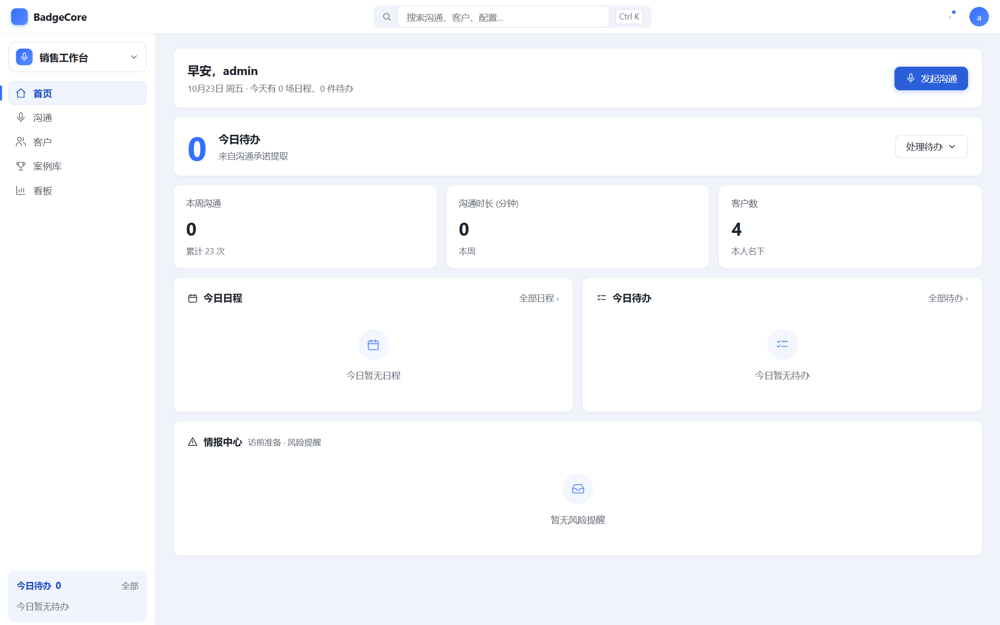
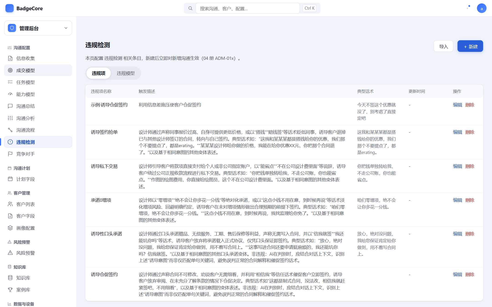
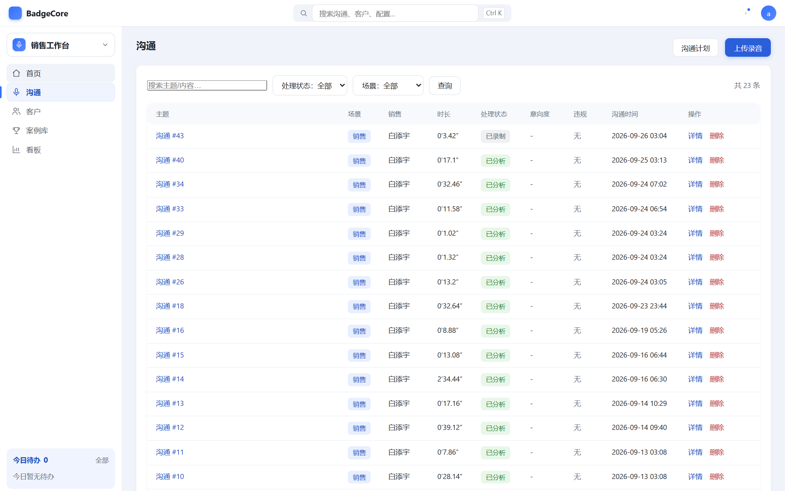
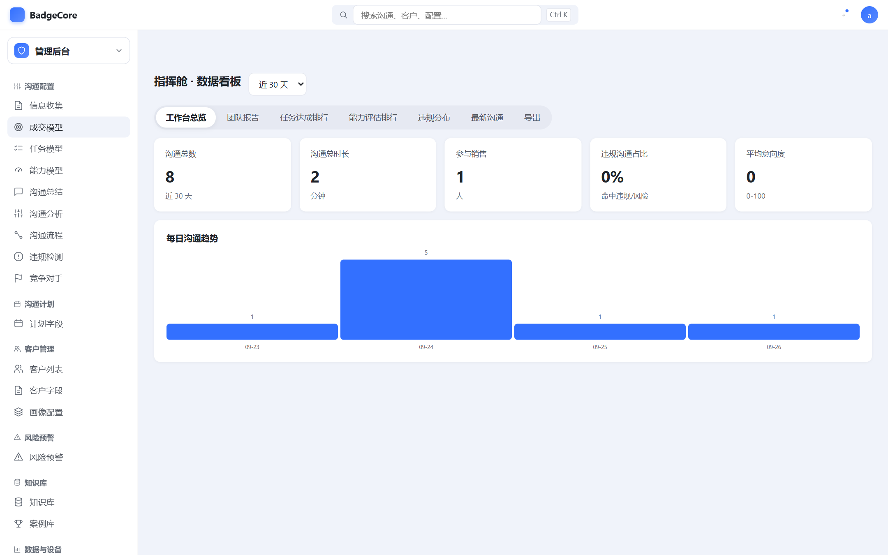
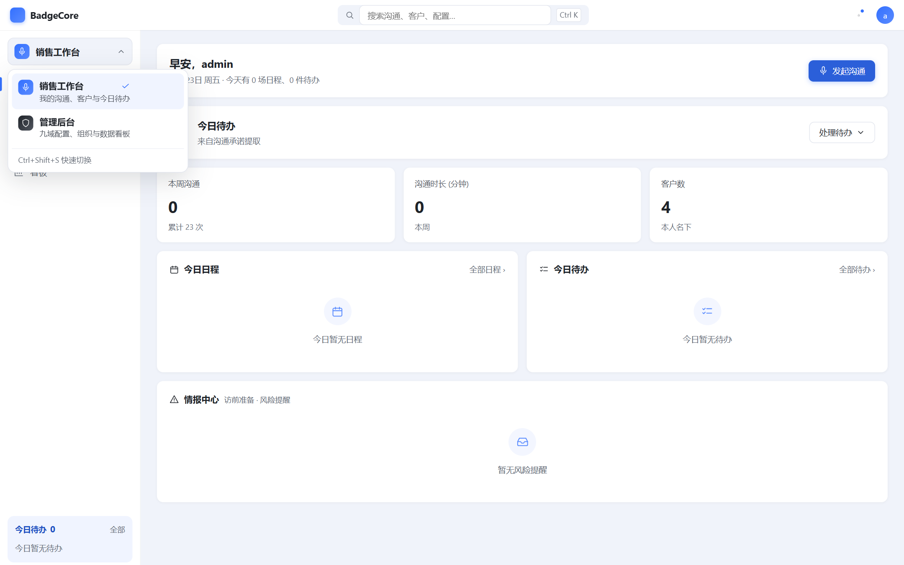
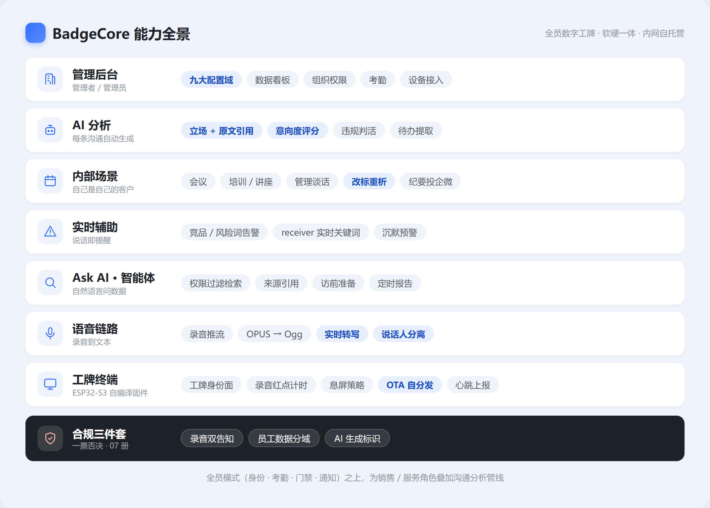
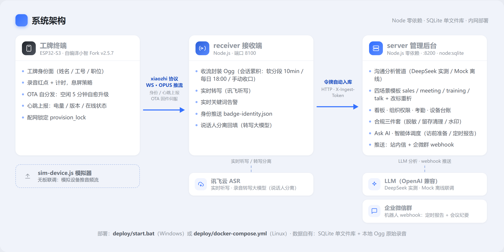

<div align="center">

# BadgeCore

**员工数字工牌 · 软硬一体的全员工牌 + AI 沟通分析**

_身份 · 考勤 · 门禁 · 通知 · 录音 · 实时转写 · AI 报告_

**让每一次沟通，都变成企业可以沉淀和经营的业务资产。**

[](https://gitee.com/bty1987/BadgeCore/stargazers)
[](https://gitee.com/bty1987/BadgeCore/fork)


</div>

---

## 这是什么

BadgeCore 是一套**跑在自己内网**的员工数字工牌系统：对全员是「身份 + 考勤 + 门禁 + 通知」低功耗智能终端，对销售/服务角色叠加「录音 → 实时转写 → AI 分析报告」的完整管线。市面六家竞品（讯飞/科金/钉钉/明略/云知声/SaleSmart）全部只做销售录音工牌，「全员基础设施」是空白——这也是 BadgeCore 的核心卖点（D1）。

**它解决的真实痛点：**

- 拜访/会议说完就散，客户聊到哪了、承诺过什么，全靠销售回忆——**录音→转写→AI 报告**解决（立场带原文引用、意向度评分、待办提取）；
- 违规承诺、竞品话术、风险词，管理层没人盯得到——**实时告警**解决；
- 会议/培训/谈话纪要靠人工整理——**内部组织场景模板**解决，同一管线直接出纪要、投企微群；
- 身份、考勤、门禁各买一套系统——**一张工牌**承载全员基础设施。

**合规底线（一票否决，07 册）**：录音双告知 · 员工数据分域 · AI 生成标识。三条红线不满足的功能一律不做。

> 命名沿用项目惯例（EcoCore / EyeCore → ArchCore → BadgeCore）。

## 界面预览

**单一壳双工作区**：销售工作台与管理后台共用一套壳；左栏顶部工作区切换器一键往返（`Ctrl+Shift+S`），切到管理后台自动落在上次访问的配置页，销售角色自动隐藏管理入口。

| 销售工作台 · 今日首页 | 管理后台 · 沟通配置九域 |
|---|---|
|  |  |

| 沟通列表 · AI 报告入口 | 指挥舱 · 数据看板 |
|---|---|
|  |  |

**工作区切换器**（下拉带两工作区描述与当前项对勾；落点有记忆——切回管理后台回到上次访问页）：



> 界面为 v3「淡蓝底分区」设计体系（2026-10-23 改版）：泛品牌蓝底 + 白卡 + 激活态三重编码；改版选型过程与三方向原型见 [design-demos/](design-demos/)。

## 能力全景



| 能力板块 | 说明 | 状态 |
|---|---|---|
| 🟪 工牌终端（固件） | 自编译小智 v2.5.7 OTA 上机：工牌身份面（层级排版/录音红点计时/电量%）、息屏（OK 长按/任意键唤醒/空闲自动）、OTA 自分发 5 分钟自愈、心跳上报三层链路落库 | ✅ 试驾全链路 |
| 🔒 配网锁定 | `provision_lock` 三态经身份通道下发 + 配网热点 WPA2，防恶意改址 | ✅ 已实现待上机 |
| 🎙️ 语音链路 | xiaozhi 协议推流、OPUS→Ogg、讯飞实时听写（实测零字错）、录音转写大模型说话人分离（6 倍速）、会话累积模式（软分段 10min/每日 18:00/手动收口） | ✅ 实测通过 |
| 🤖 AI 分析 | 报告自动生成：立场带原文引用/意向度评分/违规判活/待办提取；DeepSeek 实测，Mock 可离线联调 | ✅ 上线 |
| 🏢 内部组织场景 | 会议/培训/谈话四场景模板 + 改标重析；talk 红线=事实层双向承诺、无情绪评分、参与者对称透明 | ✅ M1+M3 |
| 🚨 实时辅助 | 竞品/风险词入库告警 + receiver 实时关键词（AI-09 一期） | ✅ 规则层 |
| 🔎 Ask AI | 关键词检索 + 权限过滤 + 来源引用（AI-08，升级路径=向量库） | ✅ 简版 RAG |
| 🤖 AI 智能体 | 访前准备清单（AI-10）+ 定时报告推送（AI-11） | ✅ Mock 版 |
| 🖥️ 管理后台 | 对标 SaleSmart 九大配置域 + 数据看板/团队报告 + 组织/角色/数据权限 | ✅ v0.2 |
| ⏰ 全员考勤 | ALL-201 判定算法/补卡/记录（05 册） | ✅ 服务端（信标网关待接入） |
| 🛡️ 合规三件套 | 脱敏双层（CMP-07）/ 留存清理+下限（CMP-08）/ 导出水印（CMP-13） | ✅ 最小批次 |
| 📨 企微推送 | 定时报告 + 会议纪要双投企微群（webhook，开关默认关；talk 不推群） | ✅ W1-S1 |
| 📟 量产硬件 | 方案商 Turnkey 询价，开发板验证全链路后启动（D11） | ⏳ 暂缓 |

> 冒烟测试 134/134（`server/smoke-test.js`，自包含临时库）。

## 与市面「销售录音工牌」的区别

| 维度 | 主流销售录音工牌（讯飞/科金/钉钉/明略/云知声/SaleSmart） | BadgeCore |
|---|---|---|
| 服务对象 | 仅销售/客服角色 | **全员**：身份/考勤/门禁/通知基础设施，业务角色叠加沟通分析 |
| 场景覆盖 | 只有客户沟通 | 客户沟通 + 内部会议/培训/谈话同一管线（自己是自己的客户） |
| 部署形态 | 厂商云端 SaaS，按坐席年费订阅 | **内网自托管**：Node 零依赖 + SQLite 单文件，备份即拷贝 |
| 数据归属 | 沟通数据存厂商云端 | 数据自有：SQLite 库 + 本地 Ogg 原始录音 |
| 硬件路线 | 方案商成品锁定 | 开发期 ESP32-S3 开源生态自编译固件；量产 Turnkey 保留设计权（D2） |
| 采购决策 | 部门级工具 | 公司级基建（全员模式是采购决策升级的核心卖点，D1） |

## 系统架构



无板子联调：`node sim-device.js --seconds 5` 模拟设备推音频流，全链路可跑。图表源文件与渲染脚本：[design-demos/diagrams.html](design-demos/diagrams.html)。

## 技术栈

| 层 | 技术 | 说明 |
|---|---|---|
| 设备端 | ESP32-S3 · 小智 AI 固件 Fork（自编译 v2.5.7）· ESP-IDF | 工牌身份面/息屏/OTA 自分发/心跳/配网锁定；补丁见 `hardware/firmware/` |
| 接收端 | Node.js ≥22.5 · ws · opusscript | xiaozhi 协议 OTA+WS，:8100 |
| 服务端 | Node.js ≥22.5 零依赖（node:http / node:sqlite，D13） | API + Web 看板 + AI-11 调度器，:8200 |
| ASR | 讯飞实时听写 + 录音转写大模型（说话人分离）；本地 faster-whisper 备选 | 双云管道实测通过 |
| LLM | OpenAI 兼容接口（DeepSeek 实测）+ Mock 模式 | 报告分析/Ask AI/智能体 |
| 推送 | 站内信 · 企微群机器人 webhook | 定时报告 + 会议纪要双投 |
| 质量 | 冒烟测试 134 项（自包含临时库） | `cd server && node smoke-test.js` |

## 快速开始（开发/演示）

```bash
# ① 后台（http://localhost:8200，admin/admin123；首次启动自动建库+生成入库令牌）
cd server && node index.js                          # 零依赖，Node ≥22.5 即可

# ② 接收端（板子配网高级选项 OTA 地址指向本机即可切流）
cd hardware/receiver && npm i && node receiver.js   # 监听 8100；配了讯飞凭据则边录边出字

# ③ 打通自动入库（receiver 环境变量，令牌见后台「设置」页）
set BADGE_SERVER=http://localhost:8200
set BADGE_TOKEN=<后台设置页的入库令牌>
#   → 设备录音结束自动进后台，配了 LLM（或 mock）即自动出分析报告

# 没有板子也能全链路联调
node sim-device.js --seconds 5                      # 模拟设备推音频流

# 转写录音
python transcribe.py sessions/<xxx>.ogg small       # 本地 faster-whisper
node asr-xunfei.js sessions/<xxx>.ogg               # 云端·讯飞听写（需 asr.config.json）
node asr-xf-transcribe.js sessions/<xxx>.ogg        # 云端·讯飞转写（说话人分离）

# 后台冒烟测试（自包含临时库）
cd server && node smoke-test.js
```

内网部署：Windows 双击 `deploy/start.bat`；Linux 用 `deploy/docker-compose.yml`。

## 目录结构

```text
BadgeCore/
├── prd/           # 10 册 PRD（00 导读必读；09=内部组织场景；10=企微集成）
├── research/      # SaleSmart 拆解档案 + DayoTag 评估（code/=对标前端代码包+文案库1531条）
├── evidence/      # 实测证据（截图 + 页面文本，仅内部）
├── hardware/      # 硬件日志（选型/拆解/外壳/集成方案）
│   ├── firmware/  # 自编译小智固件补丁（工牌身份/配网锁定）+ 构建环境文档
│   └── receiver/  # 接收服务端：xiaozhi OTA+WS、录制+实时转写+身份推送
├── server/        # 管理后台 + LLM 分析管道（零依赖栈 D13）
│   └── public/    # Web 前端（登录/看板/沟通报告/配置/设置）
├── deploy/        # 部署（Windows start.bat / Docker compose）
├── docs/          # 工程文档（会话模式/客户场景/性能容量评估）
└── tools/         # 工具脚本
```

## 文档索引

| 文档 | 说明 |
|---|---|
| [prd/00-README.md](prd/00-README.md) | PRD 导读（10 册导航、需求编号规则、术语表） |
| [01-产品主PRD](prd/01-产品主PRD.md) | 背景/定位/用户画像/场景/产品架构/里程碑 |
| [03-录音与沟通分析](prd/03-软件PRD-录音与沟通分析.md) | 录音链路、实时转写、沟通分析报告 |
| [04-管理后台与权限](prd/04-软件PRD-管理后台与权限.md) | 九大配置域、组织/角色/数据权限、开放平台 |
| [05-全员工牌扩展](prd/05-软件PRD-全员工牌扩展.md) | 身份/考勤/门禁/通知（全员差异化） |
| [06-AI能力PRD](prd/06-AI能力PRD.md) | ASR、说话人分离、LLM 分析、智能体、Ask AI |
| [07-合规与隐私专册](prd/07-合规与隐私专册.md) | 录音告知、个保法/数安法、员工数据边界 |
| [08-竞品分析与对标](prd/08-竞品分析与对标.md) | SaleSmart 完整拆解（实测）+ 竞品参数对照 |
| [09-内部组织场景](prd/09-软件PRD-内部组织场景.md) | 会议/培训/谈话场景模板化（D22） |
| [10-企微集成方案](prd/10-企微集成方案.md) | 企微群 webhook 双投（W1，D23） |
| [02-硬件PRD](prd/02-硬件PRD.md) | 全自研工牌：ID/结构/选型/音频/电源/产测/量产 |
| [hardware/HARDWARE-LOG.md](hardware/HARDWARE-LOG.md) | 硬件开发日志（选型/采购/到货/协议要点） |
| [hardware/firmware/小智-Passport试驾-环境与构建.md](hardware/firmware/小智-Passport试驾-环境与构建.md) | 自编译小智固件构建环境与流程 |
| [docs/会话模式设计-明确与连续.md](docs/会话模式设计-明确与连续.md) | 会话累积模式设计（D22 拍板） |
| [docs/性能容量评估与部署规划.md](docs/性能容量评估与部署规划.md) | 性能容量评估与部署规划 |
| [DECISIONS.md](DECISIONS.md) | 决策日志 D1~D23（每条含决策/理由/放弃的选项） |

## 里程碑与当前进度

| 阶段 | 状态 | 说明 |
|---|---|---|
| 对标拆解 | ✅ 完成 | SaleSmart 逆向 + 实测；2026-09-11 代码包重抓（121 路由/43 命名页，文案库 1531 条） |
| PRD v0.1 | ✅ 完成 | 10 册；企业内部使用，v0.1 即工作基线（D11，不做正式评审） |
| 硬件选型 | ✅ 完成 | 开发载体微雪 ESP32-S3-Touch-AMOLED-1.75C 已验收 |
| 设备端固件 | ✅ 试驾全链路 | 自编译小智 v2.5.7 OTA 上机；配网锁定已实现待上机（06d4647） |
| 软件管道 | ✅ 打通 | 录音推流 → 服务端 → OPUS → 转写；receiver v0.4（实时转写+身份推送+会话累积） |
| 云 ASR / LLM | ✅ 实测通过 | 讯飞双管道 + DeepSeek 分析（2026-09-12 起） |
| 管理后台 / AI 能力 | ✅ v0.2 | 九大配置域 + 看板/团队报告 + Ask AI + 智能体 + 合规三件套 + 实时告警（D14~D17）；UI v3「淡蓝底分区」改版：单一壳 + 工作区切换器（10-23） |
| 内部组织场景 | ✅ M1+M3 | 四场景模板+改标重析+talk 红线+会话累积（09 册，D22） |
| 企微推送 | ✅ W1-S1 | 定时报告+会议纪要双投企微群（10 册，D23；冒烟 134/134） |
| 全员考勤 | ✅ 服务端 | ALL-201 判定/补卡/记录，待信标网关实物接入（D14） |
| 量产硬件 | ⏳ 暂缓 | 开发板验证全链路后再启动方案商询价（D11）；当前冻结发版攒电量数据 |

## 常见问题（FAQ）

**Q：没有工牌硬件能体验吗？**
能。`node sim-device.js --seconds 5` 模拟设备推音频流，LLM 配 mock 模式即可无硬件跑通「推流→转写→分析报告」全链路。

**Q：数据会出网吗？**
录音（Ogg）与转写文本存自己内网的 SQLite 单文件库；实时转写与 LLM 分析调用讯飞/DeepSeek 云 API 时数据出网，可切本地 faster-whisper。上线前按 07 册合规专册完成告知与评估。

**Q：默认账号是什么？**
admin / admin123（首次启动自动建库并生成入库令牌），正式使用请改密。

**Q：量产硬件什么时候有？**
开发板全链路验证后再启动方案商 Turnkey 询价（D11/D2：一期方案商定制，演进全自研）。当前冻结发版攒设备电量数据，为量产电源设计提供依据。

**Q：固件怎么改？**
设备端是小智 AI 开源项目的自编译 Fork（v2.5.7），工牌身份面与配网锁定以补丁形式维护在 `hardware/firmware/`，构建环境见[固件构建文档](hardware/firmware/小智-Passport试驾-环境与构建.md)。

## 风险提示与使用边界

- 录音涉及员工与客户双方个人信息：**录音双告知 / 员工数据分域 / AI 生成标识**三条红线一票否决（07 册），talk（管理谈话）场景另有权限收紧与不推群约束（09 册）。
- `evidence/` 内截图含真实姓名与组织信息，仓库仅限内部，转公开前必须脱敏；对标产品的账号凭证、登录态永不入库。
- 浏览器抓取工具暂存于旧工作区 `xmate-research/browser/`（playwright-core 驱动 Edge），其 `profile/` 目录含登录态，**严禁提交仓库**（已在 .gitignore 排除）。

## 许可证

本项目暂未附带开源许可证，**默认保留所有权利（All Rights Reserved）**。当前面向内部研发与试点；如需评估、试用或二次集成，请先与作者取得联系。
